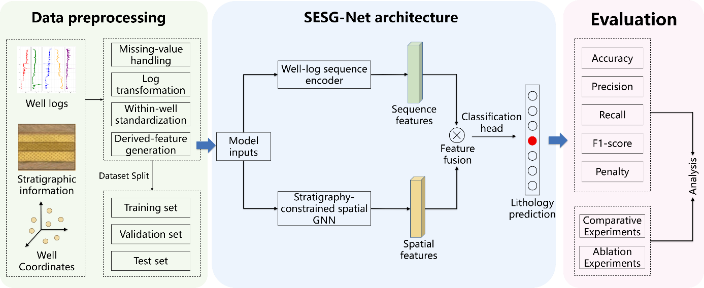
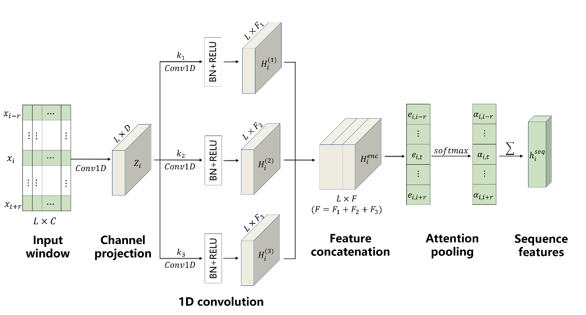
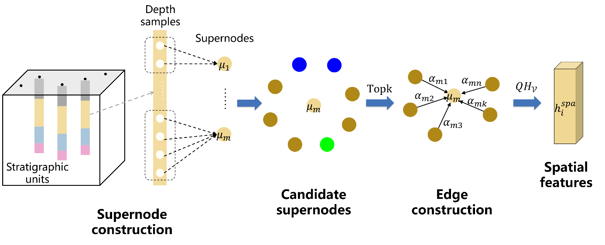

# SESG-Net

SESG-Net is a lithology identification framework that integrates **well-log sequence information, inter-well spatial relationships, and stratigraphic constraints**.

This repository provides the implementation for data preprocessing, model training, baseline comparison, ablation studies, and model evaluation, supporting reproducibility of the experiments reported in the accompanying study.

## Repository Structure

```text
.
|-- data/
|   |-- split_manifest.csv
|   |-- sample/
|   `-- README.md
|-- docs/
|   |-- assets/
|   |-- method.md
|   `-- reproduction.md
|-- experiments/
|   |-- ablations/component_ablation.py
|   |-- baselines/compare_models.py
|   `-- testing/evaluate.py
|-- src/SESG_Net/
|   |-- __init__.py
|   |-- cli.py
|   |-- config.py
|   |-- dataset.py
|   |-- model.py
|   |-- preprocessing.py
|   `-- training.py
|-- tests/test_pipeline.py
|-- train.py
|-- requirements.txt
`-- pyproject.toml
```

Main files and modules are organized as follows:

| Path                                          | Description                                     |
| --------------------------------------------- | ----------------------------------------------- |
| `train.py`                                    | Main entry point for SESG-Net training          |
| `src/SESG_Net/config.py`                      | Dataset, model, and training configurations     |
| `src/SESG_Net/preprocessing.py`               | Data preprocessing and graph construction       |
| `src/SESG_Net/dataset.py`                     | Construction of well-log sequence windows       |
| `src/SESG_Net/model.py`                       | Implementation of the SESG-Net architecture     |
| `src/SESG_Net/training.py`                    | Training, prediction, and evaluation procedures |
| `experiments/baselines/compare_models.py`     | Baseline comparison experiments                 |
| `experiments/ablations/component_ablation.py` | Component ablation experiments                  |
| `experiments/testing/evaluate.py`             | Evaluation on the test set                      |
| `tests/test_pipeline.py`                      | Automated tests for the data and model pipeline |
| `data/README.md`                              | Dataset source and input data description       |
| `docs/method.md`                              | Method and implementation description           |
| `docs/reproduction.md`                        | Experiment reproduction guide                   |

## Method Overview



*Fig. 1. Overall workflow of SESG-Net.*

SESG-Net uses ten well-log curves: GR, RDEP, RMED, RSHA, RHOB, NPHI, DTC, SP, CALI, and PEF. Missing-value indicators are generated before imputation. Resistivity curves are transformed logarithmically, and continuous curves are standardized within each well. The processed inputs are passed to the well-log sequence encoder and the stratigraphy-constrained spatial graph neural network.

### Well-log Sequence Encoding



*Fig. 2. Well-log sequence encoding module.*

For each target depth, the sequence branch constructs a centered window of 129 samples. Parallel one-dimensional convolutions with kernel sizes of 9, 19, and 39 extract multiscale response patterns. The well-log features and their corresponding missing-value indicators are synchronously encoded within the sequence branch to obtain the vertical sequence representation.

### Stratigraphy-constrained Spatial Graph



*Fig. 3. Stratigraphy-constrained spatial graph neural network module.*

Consecutive samples with similar responses are grouped into supernodes. Cross-well candidate nodes are searched within the stratigraphic context and spatial radius. The dynamic edge scorer selects 10 neighboring supernodes, and GraphSAGE aggregates their features. The sequence representation, which incorporates missing-state information, is fused with the spatial representation for sample-level lithology prediction.

## Installation

Python 3.8 to 3.11 is supported.

```bash
python -m venv .venv
source .venv/bin/activate

python -m pip install --upgrade pip
python -m pip install -r requirements.txt
python -m pip install -e .
```

For GPU acceleration, install a PyTorch version compatible with the local CUDA environment. The code can also be executed on CPU.

## Data Preparation

The experiments are based on the [FORCE 2020 Well Log Lithology Dataset](https://zenodo.org/records/4351156).

The fixed assignment of 98 training wells, 10 validation wells, and 10 blind-test wells is provided in `data/split_manifest.csv`.

Detailed information about data acquisition, required columns, lithology labels, and penalty-matrix order is provided in:

```text
data/README.md
```

The processed dataset should be organized as follows:

```text
data/
|-- split_manifest.csv
|-- train.csv
|-- val.csv
|-- test.csv
`-- penalty_matrix.npy
```

where:

* `split_manifest.csv`: fixed 98/10/10 well assignment
* `train.csv`: training dataset
* `val.csv`: validation dataset
* `test.csv`: test dataset
* `penalty_matrix.npy`: lithology misclassification penalty matrix

The CSV files use a semicolon delimiter. Training, validation, and test wells must be disjoint. The complete FORCE 2020 dataset is not included in this repository.

## Model Training

Run the following command from the repository root:

```bash
python train.py \
  --train-csv data/train.csv \
  --val-csv data/val.csv \
  --penalty-matrix data/penalty_matrix.npy \
  --output-dir outputs/reference
```

Model settings and training parameters can be found in:

```text
src/SESG_Net/config.py
src/SESG_Net/cli.py
```

After training, the main outputs are saved to:

```text
outputs/reference/
|-- sesg_net_state_dict.pt
|-- validation_predictions.csv
`-- metrics.json
```

## Baseline Comparison

To evaluate the comparative models, including RF, XGBoost, CatBoost, MLP, BiLSTM, TCN, and GAT, run:

```bash
python experiments/baselines/compare_models.py
```

The corresponding results are saved in:

```text
outputs/baselines/
```

The comparison results are shown below.

| Model | Accuracy | Precision | Recall | F1-score | Penalty |
|---|---:|---:|---:|---:|---:|
| SESG-Net | 81.46 | 80.09 | 81.46 | 80.36 | -0.47 |
| RF | 79.89 | 76.88 | 79.89 | 76.27 | -0.52 |
| XGBoost | 79.69 | 76.93 | 79.69 | 76.84 | -0.52 |
| CatBoost | 76.90 | 77.89 | 76.90 | 76.86 | -0.61 |
| MLP | 73.46 | 75.40 | 73.46 | 73.98 | -0.71 |
| BiLSTM | 73.25 | 72.60 | 73.25 | 72.64 | -0.67 |
| TCN | 69.75 | 72.00 | 69.75 | 70.57 | -0.76 |
| GAT | 72.90 | 69.05 | 72.90 | 70.26 | -0.71 |

## Ablation Studies

Component ablation experiments can be executed using:

```bash
python experiments/ablations/component_ablation.py
```

The experiments include the following configurations:

* well-log sequence encoding
* spatial graph neural network
* stratigraphy-constrained spatial graph neural network
* sequence-spatial graph fusion
* SESG-Net without missing-value indicators
* complete SESG-Net

The results are saved in:

```text
outputs/ablations/
```

The ablation results are shown below.

| Group | Sequence encoding | Spatial graph | Stratigraphic constraint | Missing-value indicators | Accuracy | Precision | Recall | F1-score | Penalty |
|---:|:---:|:---:|:---:|:---:|---:|---:|---:|---:|---:|
| 1 | ✓ | — | — | ✓ | 77.89 | 75.17 | 75.93 | 75.57 | -0.56 |
| 2 | — | ✓ | — | — | 70.36 | 65.36 | 70.36 | 67.10 | -0.84 |
| 3 | — | ✓ | ✓ | — | 76.65 | 75.09 | 76.65 | 75.03 | -0.63 |
| 4 | ✓ | ✓ | — | ✓ | 80.11 | 78.15 | 80.11 | 77.97 | -0.51 |
| 5 | ✓ | ✓ | ✓ | — | 79.69 | 78.54 | 79.69 | 78.94 | -0.51 |
| 6 | ✓ | ✓ | ✓ | ✓ | 81.46 | 80.09 | 81.46 | 80.36 | -0.47 |

## Evaluation

After training the complete SESG-Net model, evaluate it on the test set using:

```bash
python experiments/testing/evaluate.py
```

The evaluation results are saved in:

```text
outputs/test/
```

Run the automated pipeline tests using:

```bash
python -m pytest -q
```

Available training options can be inspected with:

```bash
python -B train.py --help
```
